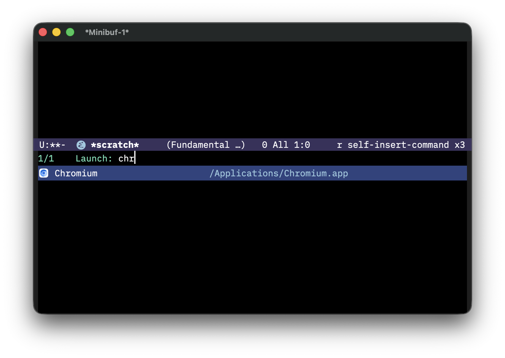

#+TITLE: launcher.el

Launch macOS applications from Emacs.

* Installation

#+begin_src emacs-lisp
(use-package launcher
  :vc (:url "https://github.com/xiaoxinghu/launcher.el" :rev :newest)
  :bind ("C-c l" . launcher))
#+end_src

* Usage

- ~M-x launcher~ — pick and launch an app
- ~C-u M-x launcher~ — rebuild index first
- ~M-x launcher-refresh~ — rebuild index without launching

Empty input shows only the input box.  Type to see matching applications,
calculations, custom tool results and web searches.  Return executes the
selected result; blank input cancels.  Results stay in tool order:
applications, calculator, then your ~launcher-tools~ in list order.

- ~c~ searches the cached app index, using your completion styles.
- ~1 + 2 * 3~ previews ~= 7~; Return copies the value and closes the launcher.
  Decimal numbers, parentheses and ~+ - * /~ are supported; ~= 42~ explicitly
  requests a calculation.  Incomplete or invalid expressions keep a calculation
  candidate showing ~= INVALID~, so default search does not appear between
  keystrokes.  Return on INVALID keeps the input and copies nothing.
- ~g~ offers the default Google search entry alongside matching applications.
  Selecting it fills ~g ~ and keeps the input open.  A prefix followed by only
  whitespace shows the tool's prefix and name without querying; selecting it
  keeps the input unchanged.
  ~g emacs~ previews a Google search, executed on Return.
- In general search, if all tools return no candidates, Launcher offers one default web search
  (~launcher-fallback-search-url~).  Input starting with ~http://~ or ~https://~
  (ignoring case) instead shows ~Open URL:~ and opens the input unchanged.
  Bare domains still use web search.  Any tool result removes this fallback;
  each search engine is an ordinary prefixed tool in ~launcher-tools~.

Space inserts text under stock completion; custom Space bindings are kept.
Tab opens stock completion choices; with Vertico, Tab inserts a result's
visible title, preserving the active tool prefix (for example, ~quit Finder~).
Prefix entries insert their prefix plus a space.  Only a current result can
execute: arbitrary text returned by a custom completion reader is not dispatched
as an action.

** Application discovery

~launcher-app-discovery-method~ selects how apps are found:

- ~spotlight~ (default): query Spotlight with ~launcher-mdfind-query~.
- ~filesystem~: recursively scan ~launcher-app-directories~ without
  entering ~.app~ bundles, so their internal helper apps are excluded.

#+begin_src emacs-lisp
(setq launcher-app-discovery-method 'filesystem) ; or 'spotlight
#+end_src

Both sources use ~launcher-app-directories~.  The filesystem scanner skips
missing directories and reports unreadable directories before continuing.
It follows explicitly configured roots, including symlinks, but does not
recurse into directory symlinks encountered below them.  Symlinks to valid
~.app~ directories are included.  Different paths to the same target remain
distinct; deduplication does not resolve symlinks.

The application list is cached in memory for the Emacs session.  After
changing discovery settings or installing/removing apps, run
~M-x launcher-refresh~ (or ~C-u M-x launcher~) to rebuild it.
~launcher-mdfind-query~ only affects Spotlight discovery; filesystem mode
does not require ~mdfind~.

** App icons

On macOS, in a graphical frame, both commands show each app's own icon
before its name, as macOS draws it.  In a terminal, or with
~(setq launcher-show-icons nil)~, the list is text only.

- Icons come from AppKit (~NSWorkspace iconForFile:~), through macOS's
  built-in ~osascript~ and the packaged script ~assets/launcher-icons.js~:
  no compiler, Homebrew package, Python or icon font.  Install that file
  with the package (~package-vc~ does; a MELPA-style recipe needs
  ~:files ("*.el" "assets/launcher-icons.js")~).
- Missing icons are drawn in the background, all at once, and never slow
  typing: an app whose icon is not ready yet shows blank space as large,
  and its icon appears when the list is next redrawn.  Drawing 500 apps'
  icons takes a few seconds, once.
- ~launcher-icon-size~ (default 20) is the list's icon size in logical
  pixels; icons stay sharp up to 32 on a Retina display.  Rows of apps and
  of tools are as tall as the icon or the line, whichever is taller.
- Icons are cached as 64-pixel PNGs in the ~v1~ subdirectory of
  ~launcher-icon-cache-directory~ (~cache/launcher/icons/~ in your Emacs
  directory), and survive restarts.
  A PNG is named after its app's path and its ~Info.plist~'s modification
  time, so an updated app gets a new icon.  ~C-u M-x launcher~ and
  ~M-x launcher-refresh~ delete the icons of apps that are gone.  An icon
  that changes without its ~Info.plist~, such as a custom Finder icon,
  goes unnoticed: ~M-x launcher-clear-icon-cache~ deletes all icons, which
  are then drawn again.  The launcher deletes only the PNGs it made.
- If an icon cannot be drawn, the app is listed and launched as usual; the
  failure is noted in the hidden buffer ~" *launcher-icons*"~ and tried
  again after the next index refresh.
- With icons, the result list's completion category is ~launcher-result~, so
  that add-ons such as ~nerd-icons-completion~ add no generic icon of
  their own; Marginalia and Vertico work as before.

Custom tools can reuse an application icon with
~:icon (launcher-icons-app "Finder")~, or supply their own image with
~:icon '(:file "/path/to/icon.png")~ or text with
~:icon (nerd-icons-faicon "nf-fa-trash")~.  Launcher does not require nerd-icons.
~launcher-icons-app~ accepts an application path or an exact, case-sensitive
name from the cached app index.  Unknown or ambiguous names return nil.
It returns ~(:file CACHE-PNG-PATH)~ even before the PNG exists, without
discovering apps or starting a worker.  Existing background generation makes
indexed app icons available on a later redraw.  Custom images are never deleted
by Launcher's cache cleanup.  Migrate former ~:icon-path APP-PATH~ fields to
~:icon (launcher-icons-app APP-PATH)~; ~:icon-path~ is no longer supported.

** Completion

~launcher~ uses your ~completing-read-function~ and completion UI.  Vertico
is optional.  Your completion styles apply to app matching, and your UI's
sorting and navigation apply to candidates.

Completion styles can interpret special characters.  With Orderless 1.8's
default configuration, ~!~ alone is ignored and shows all applications;
~!chro~ excludes applications matching ~chro~, such as Chrome and Chromium.
~chro~ matches those applications, while =~crm= uses fuzzy matching and can
match Chromium.  The available syntax depends on your Orderless version and
configuration.  A complete tool prefix followed by a space routes the remaining
input to that tool; search engines receive the query text unchanged.

Successful actions record stable candidate IDs in ~launcher-selection-history~,
separately from query text history.  With Vertico, a history-aware sorter such as
~vertico-sort-history-alpha~ can prioritize recent selections.  Add
~launcher-selection-history~ to ~savehist-additional-variables~ to persist them.
Renaming a tool or changing its prefix changes its candidate IDs.

** Built-in icons

~launcher-builtin-icons~ (default nil) is an alist for ~calculator~, ~search~
and ~url~ icons.  ~calculator~ covers valid and invalid calculations; ~search~
covers fallback web searches and search tools without their own icon; ~url~
covers directly opening a URL.  Missing entries show blank icon slots.

#+begin_src emacs-lisp
(setq launcher-builtin-icons
      (when (featurep 'nerd-icons)
        `((calculator . ,(nerd-icons-faicon "nf-fa-calculator"))
          (search     . ,(nerd-icons-faicon "nf-fa-search"))
          (url        . ,(nerd-icons-faicon "nf-fa-link")))))
#+end_src

Load ~nerd-icons~ before evaluating this example to configure the icons.

Values use the existing icon formats: nil, a string (with text properties),
or ~(:file PNG-PATH)~.  Launcher does not require nerd-icons.
Tools and candidates may use ~:icon '(:builtin KEY)~ to reference one of these
three icons.  References resolve when displayed, so changing the alist also
updates previously configured tools.  Alist values cannot themselves reference
another built-in icon.  Ordinary tools and candidates still use explicit nil
or ~""~ for a blank icon, and application icons continue to come from macOS.

** Tools

~launcher-tools~ configures tools after the built-in applications and calculator.
It defaults to the Google (~g~) search tool.
~setq~ replaces the entire list, including those defaults; setting it to ~nil~
removes all configured tools.  Applications, calculator and the unprefixed
fallback controlled by ~launcher-fallback-search-url~ remain available.

~launcher-search-tool~ constructs an ordinary tool entry without changing
~launcher-tools~.  Supply a nonempty prefix without whitespace, a nonblank
~:name~, a nonblank ~:url~ template and an optional ~:icon~.  The template uses
Emacs format-string syntax: ~%s~ receives the URL-encoded query and ~%%~ is a
literal percent sign.  Blank queries show the prefix entry; selecting a search
result opens its URL.  An omitted or nil ~:icon~ uses the shared ~search~ icon
from ~launcher-builtin-icons~.  An explicit icon overrides it; ~:icon ""~ keeps
that search tool's icon blank.

To add a search tool while keeping the current list:

#+begin_src emacs-lisp
(add-to-list 'launcher-tools
             (launcher-search-tool
              "w" :name "Wikipedia"
              :url "https://en.wikipedia.org/w/index.php?search=%s"
              :icon "📚"))
#+end_src

A tool has an optional prefix and icon, a required name, and three
source/action properties:
~:candidates~ supplies a static list, ~:query~ supplies dynamic results,
and ~:submit~ executes the selected candidate.

#+begin_src emacs-lisp
(defun my-definition-query (query)
  (unless (string-blank-p query)
    (list (list :id query :title query :subtitle "Look up definition"
                :data query))))

(defun my-definition-submit (candidate)
  (my-dictionary-lookup (plist-get candidate :data)))

(setq launcher-tools
      (list
       (launcher-search-tool "gh" :name "GitHub"
                             :url "https://github.com/search?q=%s" :icon "🔎")
       '("d" :name "Dictionary" :icon "📖" :query my-definition-query
             :submit my-definition-submit :debounce 0.2)
       '("fav" :name "Favorites"
               :candidates ((:id emacs :title "Emacs" :data "https://www.gnu.org/software/emacs/"))
               :submit my-favorite-submit)))

(defun my-favorite-submit (candidate)
  (browse-url (plist-get candidate :data))
  nil)
#+end_src

Typing ~d hello~ keeps the complete input in the box, passes ~hello~ to
~:query~, and queries only that tool.  Without a prefix, all unprefixed
tools participate.  Only selecting a result calls ~:submit~.

- PREFIX is nil, ~""~, or a single string without whitespace.  It matches
  case-sensitively when followed by an ASCII space.  Prefixes must be
  unique within ~launcher-tools~.  Before the space, prefix
  entries appear alongside general results; selecting one fills its prefix
  and a space.  Tool names are labels, not searchable entry aliases.
- ~:candidates~ is a complete list of candidate plists or a no-argument
  function returning one.  Launcher loads it lazily once per input session,
  caching empty lists and errors too.  Reopening Launcher reloads it.
  Every input change matches the full cached list using completion styles,
  category ~launcher-tool~, ignoring case.  Only ~:title~ is searched;
  duplicate titles remain distinct candidates.  Application matching
  continues to use ~launcher-app~.
- ~:query~ receives unchanged query text and returns already matched
  dynamic candidates.  Launcher does not filter them again.  Static and
  dynamic sources may coexist or both be absent; with neither there are
  no content candidates, even if ~:submit~ is configured.
- Candidates require a stable, non-nil ~:id~ and nonblank string ~:title~.
  Optional fields are ~:subtitle~, ~:icon~ and arbitrary ~:data~.
  A tool's ~:icon~ is shown on its prefix entry and inherited by static and
  dynamic candidates without ~:icon~.  An explicit candidate ~:icon~ overrides
  it, including ~nil~ or ~""~ for a blank slot.  Tools and candidates use the
  same icon formats below.
  ~:icon~ accepts a string (including text properties, as returned by
  nerd-icons), ~(:file PNG-PATH)~, ~(:builtin KEY)~, or nil.
  PNGs use ~launcher-icon-size~;
  text icons keep their font and color properties and are centered in a slot
  at least ~launcher-icon-size~ pixels wide.  Empty strings use the same blank
  slot as nil.  Text wider than the slot keeps its original size.  All icons follow
  ~launcher-show-icons~ and the existing graphical display requirements.
  Missing or unusable images show blank space without blocking actions.
  IDs must be unique within each source.  Static matches appear first;
  dynamic results with the same ID replace them in place, and remaining
  dynamic results follow in their returned order.  Equal titles do not
  imply equal identity.  Source errors are independent: surviving results
  remain available, with errors shown in the status area.
- Every tool with a candidate source requires ~:submit~.  It receives the
  selected candidate, including its ~:data~, and returns nil after an action,
  a live non-minibuffer buffer to display, or ~(:input STRING)~ to replace
  the input and keep querying.  Submission errors keep input for retry.
  Loading and querying must generate data without performing submit actions.
- ~:debounce~ is a finite nonnegative delay in seconds, default 0, affecting
  dynamic queries only.  Static matches appear immediately.  New input
  cancels old timers and invalidates old candidates; obsolete results cannot
  publish.  Navigation does not query again.  Queries are synchronous, so
  debouncing reduces calls but does not make slow queries nonblocking.
- Completely blank input shows no results and loads no sources.  An explicit
  prefix with a blank query (~play ~) shows all static candidates without
  calling ~:query~.  A tool without a static source instead shows its prefix
  entry.  Explicit searches never use default web-search fallback.
- Successful selections record stable IDs in ~launcher-selection-history~.
  Nonblank full inputs, including canceled searches and prefixes with spaces,
  are recorded in ~minibuffer-history~ on exit.  ~M-p~/~M-n~ browse this same
  history across tools; ~savehist-mode~ can persist it.
- Result buffers are displayed after the minibuffer closes through
  ~pop-to-buffer~.  Launcher does not kill them.  Application discovery
  failures do not prevent custom tools from working.

*** Migration

Tool and candidate ~:function~ properties are no longer supported and report
an explicit migration error.  Move execution into a tool's ~:submit~ and
carry its arguments in candidate ~:data~.  A former submit-only tool must
now provide ~:query~ to create a candidate, as in the Dictionary example
above.  The former ~:history~ property remains unsupported.

*** Music playlist example

The provider reads the M3U once per Launcher session and retains each song's
original playlist index.  Typing ~play ~ lists songs; text after ~play ~
filters their titles using your completion settings.

#+begin_src emacs-lisp
(require 'cl-lib)

(defun my/music-candidates ()
  (let ((playlist (expand-file-name my/mpv-music-playlist)))
    (unless (equal (file-name-extension playlist) "m3u")
      (user-error "Invalid M3U playlist: %s" playlist))
    (with-temp-buffer
      (insert-file-contents playlist)
      (let ((songs (seq-remove
                    (lambda (line) (or (string-empty-p line)
                                       (string-prefix-p "#" line)))
                    (split-string (buffer-string) "[\r\n]+" t))))
        (cl-loop for song in songs for index from 0
                 collect (list :id index :title (file-name-nondirectory song)
                               :subtitle song
                               :data (list :playlist playlist :index index)))))))

(defun my/play-song (candidate)
  (let ((data (plist-get candidate :data)))
    (mpv-start "--volume=30" "--no-video" "--loop-playlist=inf"
               "--no-resume-playback"
               (format "--playlist-start=%d" (plist-get data :index))
               (plist-get data :playlist)))
  nil)

(add-to-list 'launcher-tools
             '("play" :name "Play Music" :candidates my/music-candidates
                      :submit my/play-song))
#+end_src

A minibuffer-only host has no ordinary window for a result buffer;
~launcher~ uses your ~pop-to-buffer~ display rules for results in ordinary
Emacs windows.  For a Portal panel, use
~(portal-launcher-present #'launcher :kind 'minibuffer)~.

** Apple Dictionary

~launcher-osx-dictionary.el~ provides ~launcher-osx-dictionary-query~ for
previews and ~launcher-osx-dictionary-submit~ to display captured definitions in Apple's dictionaries with the
[[https://github.com/xuchunyang/osx-dictionary.el][osx-dictionary]] package.  Launcher does not depend on that package, and
registers no prefix for it; choose your own:

#+begin_src emacs-lisp
(use-package osx-dictionary :ensure t)
(require 'launcher-osx-dictionary)
(setq launcher-tools
      '(("d" :name "Dictionary"
              :query launcher-osx-dictionary-query :debounce 0.2
              :submit launcher-osx-dictionary-submit)))
#+end_src

Then ~d hello~ previews a definition after 200 ms without input changes.
Return on the dictionary candidate shows the captured definitions without
looking them up a second time, rendered by osx-dictionary in
its own mode, displayed by ~launcher~ through ~pop-to-buffer~.  The lookup
itself opens nothing: no Dictionary.app, browser, second prompt, window or frame.

- Surrounding whitespace is trimmed; otherwise the word is looked up as
  typed, so phrases and non-ASCII words work.  osx-dictionary's choice of
  dictionaries (~osx-dictionary-select-dictionary~,
  ~osx-dictionary-allowed-dictionaries~) and search log apply.  Previews
  leave the log untouched; selecting a definition logs the chosen word.
- Results go to the buffer ~*Launcher Dictionary*~
  (~launcher-osx-dictionary-buffer-name~), reused by each lookup: the
  package's own ~*osx-dictionary*~ session is left alone.  A lookup that
  fails leaves the previous result as it was.
- The result uses the familiar dictionary keys, with launcher-specific
  commands in this buffer only (~launcher-osx-dictionary-result-mode~):
  ~q~ quits the window as ~quit-window~ and ~s~ reopens launcher with the
  configured dictionary prefix (for example, ~d ~) ready for another word
  and its preview, retaining the originating prefix when there are multiple
  dictionary tools.  Canceling leaves the current result in place.  ~S~ chooses
  the dictionaries, then looks the word up again in this buffer.  ~o~
  opens Dictionary.app with the word or phrase encoded as a URL.  ~r~
  reads aloud without blocking Emacs; pressing it again restarts speech.
  Refreshing, quitting or killing the result stops its speech.  ~?~ shows
  mode help as usual.
  Results disable ~view-mode~ if user hooks enabled it, so its search
  bindings do not shadow the dictionary keys; the buffer stays read-only.
- The lookup is synchronous: Emacs waits for it, typically well under a
  second, and quitting does not cancel it.
- It needs macOS, osx-dictionary, and its native helper
  ~osx-dictionary-cli~.  If the helper is missing, the first lookup builds
  it into the package's directory, as the package itself would, which
  needs Xcode's command line tools (~xcode-select --install~).  With preview
  enabled, the first debounced query can build the helper.  For lookups only on Return, supply a lightweight ~:query~ that returns
  the word in ~:data~, and a ~:submit~ wrapper calling
  ~launcher-osx-dictionary-lookup~ with that word.
- Failures keep the query and its text, and say what went wrong: another
  platform, a missing package, an incompatible version, a missing helper
  source, compiler or writable directory, a failed build or helper, no
  installed dictionaries, a chosen dictionary that is not installed, or no
  definition.  The helper reports no errors of its own, and finds nothing
  both for an unknown word and for a failure while searching.  So only
  when it finds nothing, the adapter checks the helper and the
  dictionaries, by listing them.
- Tested with osx-dictionary commit ~655bca5~ (2026-09-06).  The package has
  no public way to look a word up without prompting and displaying, so
  the adapter uses its private ~osx-dictionary--insert-search-result~,
  ~osx-dictionary--current-dictionary-description~,
  ~osx-dictionary--current-word~ and ~osx-dictionary--load-dir~, and
  reports a version that lacks them.

* Development

Run the regression tests without Vertico, launching apps or opening a browser:

#+begin_src sh
sh test/elpa.sh   # pinned packages, into .cache/elpa
emacs --batch -Q -L . -L test -l test/launcher-tests.el \
  -l test/launcher-tools-tests.el -l test/launcher-candidates-tests.el \
  -l test/launcher-osx-dictionary-tests.el \
  -l test/launcher-icons-tests.el -l test/launcher-icons-worker-tests.el \
  -f ert-run-tests-batch-and-exit
#+end_src

The icon cache checks (~test/launcher-icons-tests.el~) replace the worker
with a fake process, so they need neither macOS nor a display.
~test/launcher-icons-worker-tests.el~ runs the real worker on system apps
and on fake bundles in temporary directories, on macOS only, and skips
elsewhere.

The dictionary checks use the pinned osx-dictionary that ~test/elpa.sh~
fetches, and skip without it.  A fake helper script stands in for its
native one, so they need neither macOS nor dictionaries, and prove no real
lookup.

Vertico's display needs a graphical Emacs.  ~bash test/vm.sh~ runs the
graphical checks (~test/gui.sh~, which loads ~test/launcher-gui-tests.el~,
~test/launcher-tools-gui-tests.el~ and ~test/launcher-icons-gui-tests.el~) in a disposable Emacs in the macOS test VM
that Portal's ~test/vm.sh~ uses, without Portal, typing through AppKit's
event queue.  It fetches pinned Vertico, Orderless and Marginalia releases
with ~test/elpa.sh~ into ~.cache/elpa~, and copies logs and screenshots back
to ~.cache/vm/~.  Never run these checks in your own Emacs session.

Real lookups in Apple's dictionaries are opt-in, also in the VM:
~bash test/vm.sh sh test/gui.sh '^launcher-dictionary-real-'~ builds the
pinned osx-dictionary's helper in a temporary copy, looks words up through
~launcher~, and logs the environment and definitions.

* Works with [[https://github.com/xiaoxinghu/m-x][M-x.app]]

M-x.app registers the ~emacs://~ URL scheme, letting you invoke Elisp from a global hotkey anywhere on macOS. Bind it to =cmd + space=, you get a system-wide app launcher — Raycast-style, but in Emacs.

* Roadmap

This is part of a broader effort to replace Raycast with Emacs.

** DONE *Search tools*
~g query~, ~gh repo~, ~yt video~ to redirect input to configurable URL templates
** TODO *Custom commands*
register named elisp actions alongside apps via ~launcher-register-command~
** TODO *Built-in extensions*
clipboard history, window management, system commands (sleep/lock/restart), file search, quick links, snippets
